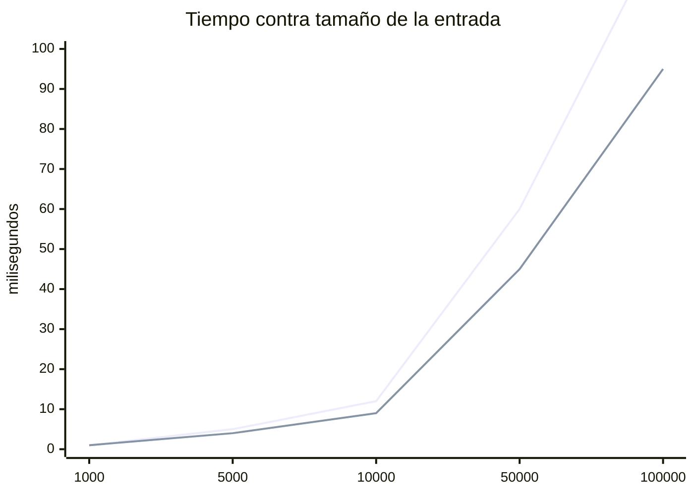

# Informe final

*(Parte del informe del avance, corregido con la realimentación.)*

## 1. El escenario y el modelado

El proyecto consiste en desarrollar un programa para manejar el inventario de una tienda. Cada producto tiene un código único, un nombre y una cantidad disponible.

El programa permite agregar productos, consultar su información, reponer unidades, eliminar productos y mostrar todos los productos registrados.

Para desarrollar el proyecto se utilizan dos estructuras de datos: una lista simplemente enlazada, que se trabajó durante el avance, y una tabla hash con encadenamiento, que se utiliza en la entrega final.

También se utiliza `std::map` de C++ como estructura de referencia para comparar el comportamiento de las estructuras implementadas.

## 2. Las dos estructuras

Para el proyecto trabajamos con dos estructuras de datos: la lista enlazada y la tabla hash con encadenamiento.

**Lista enlazada:**

La lista enlazada guarda los productos en nodos. Cada nodo tiene el código, el nombre, la cantidad y un enlace al siguiente producto. Para encontrar un producto hay que recorrer la lista hasta encontrar su código.

**Tabla hash con encadenamiento:**

La tabla hash organiza los productos usando su código para calcular en qué posición se guardan. Si varios productos quedan en la misma posición, se utiliza una lista enlazada para guardar todos esos productos.

Aunque las dos estructuras guardan la información de forma diferente, ambas permiten agregar, consultar, reponer, eliminar y listar los productos.

También utilizamos `std::map` de C++ para comparar nuestros resultados con los de una estructura que ya viene incluida en el lenguaje.

## 3. Análisis formal de complejidad

Una demostración por operación no trivial, en cuatro partes:

**Teorema.** (Enunciado con la cota.)

**Demostración.** Se procede de forma directa. (La estrategia.)

*Desarrollo.* (La cadena de desigualdades, con la justificación de cada
paso.)

$$T(n) = \ldots \leq c \cdot n^2 \quad \text{para todo } n \geq k$$

*Conclusión.* Por lo tanto, $T(n) \in O(n^2)$ con testigos $c = \ldots$
y $k = \ldots$

Resumen de costos:

| Operación | Desde cero | De la biblioteca | Por qué |
|---|---|---|---|
|  |  |  |  |

## 4. Experimentos

Máquina, compilador y banderas con que se midió; cómo se generaron las
entradas; cuántas repeticiones por tamaño.

| $n$ | desde cero (ms) | biblioteca (ms) |
|---|---|---|
| 1000 |  |  |
| 5000 |  |  |
| 10000 |  |  |
| 50000 |  |  |
| 100000 |  |  |

## 5. Lo medido contra lo predicho

(¿Coincide la curva con la cota? Donde no coincida, expliquen por qué:
la constante oculta, la memoria caché, el crecimiento del vector.)

## 6. Conclusiones

(Cuál estructura conviene para este escenario y bajo qué condiciones
cambiaría la respuesta.)
